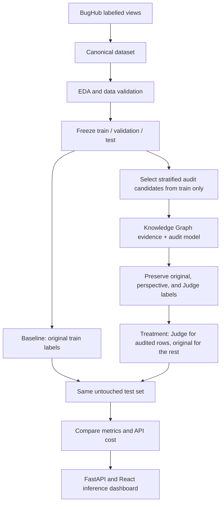

# Multi-Agent Software Defect Prediction

This research project studies whether auditing BugHub issue labels with language-model reasoning can improve a Software Defect Prediction (SDP) classifier.

The experiment compares an original-label baseline with a treatment whose training targets use Judge labels for audited records. The retained baseline and treatment metrics use the same frozen test identities, but available artifacts do not verify that the XGBoost configurations match. Treat current metric differences as descriptive until a configuration-matched rerun is completed.

- **Baseline:** BugHub's original source label for every training issue.
- **Treatment:** the Judge label for audited training issues and the original label for all other training issues.

BugHub's source labels are the project's starting labels. They are not assumed to be human-reviewed gold labels. Model-generated audit labels are also not ground truth unless separately verified.

## Project workflow



## Current state — 30 October 2026

| Stage | State and outcome |
|---|---|
| Canonical data and EDA | Complete. Canonical Parquet has 926,461 records: 648,841 `bug`, 277,620 `non-bug`. |
| Model-ready frozen split | Available: 648,424 train, 138,948 validation, 138,949 test (926,321 total; seed 42). |
| Baseline | Locally trained and tuned on CUDA using the frozen split. Current held-out accuracy 0.8043, ROC-AUC 0.8561, macro-F1 0.7546. Model/results are retained under `outputs/models/baseline/fixed_split/tuned_xgboost/` and `outputs/results/baseline/fixed_split/tuned_xgboost/`. |
| Knowledge Graph | Training-only graph built from the 648,424 frozen training rows; summary reports 2,571 nodes and 2,570 edges. Artifacts are under `outputs/knowledge_graph/train_only/`. |
| Audit sample | A 10,000-record stratified sample was selected from the frozen training split across 79 projects (seed 42). Its selection summary and identity list are under `outputs/results/audit_sampling/`. |
| Agent audit | 10,000 records completed using **one LLM call returning Policy, Data, Pattern, and Judge perspectives**. 1,573 Judge labels differ from source labels (15.73%). These are role outputs from one model response, not independent calls or verified ground truth. |
| Treatment dataset | The current treatment summary records 648,424 training rows: Judge labels for 10,000 audited identities and source labels for the remaining 638,424. It records 1,573 label changes, preservation of `original_label`, and unchanged validation/test labels. The treatment training Parquet is absent from this checkout, so the merged rows cannot be independently inspected here. |
| Treatment model | Current saved model was evaluated on the frozen 138,949-row test set: accuracy 0.7849, balanced accuracy 0.7183, macro-F1 0.7290, ROC-AUC 0.8299, MCC 0.4642, and Brier score 0.1483 (threshold 0.55). Artifacts are under `outputs/models/treatment/` and `outputs/results/treatment/`. |
| Comparison status | The retained baseline metrics (`outputs/results/baseline/full/metrics.json`) and treatment metrics have the same test identity hash. The baseline is not the separately tuned baseline shown above, and available artifacts do not establish a matched XGBoost configuration. Current differences are descriptive; do not present them as an isolated causal effect of label auditing. The comparison figure was regenerated on 30 October from the current comparison summary. |
| Application | FastAPI backend and React frontend support text and CSV/XLSX treatment inference. Local DeBERTa and XGBoost inference explicitly require CUDA; low-confidence review and OOD detection remain disabled. The audit and comparison views report current artifact counts and separate inference readiness from experimental-comparison limitations. |

### Current audit and treatment counts

The selected 10,000-record audit sample was stratified by project and original label and selected from the frozen training split. Completed audit records are in `outputs/results/audited_train_10000/audited_records.json`; the current treatment summary is in `outputs/results/treatment/treatment_dataset_summary_current.json`. The 10,000-row audit candidate Parquet and merged treatment training Parquet are absent from this checkout, so those row-level inputs should be restored for a fully reproducible rebuild.

The new training-only graph is built with `python -m src.knowledge_graph.build_training_kg`. It reads only `data/processed/fixed_splits/train.parquet`; the retriever excludes the current issue's original label from its own project/component/severity rates. The previous mixed-split graph artifacts are historical and are not used by the new audit retriever.

## Data and labels

The source dataset is assembled from BugHub's labelled views:

```text
issues.vw_bugzilla_data
issues.vw_github_data
issues.vw_jira_data
```

The project uses the processed canonical dataset, not the entire BugHub population. Important files and invariants:

```text
Canonical dataset: data/processed/bughubs_canonical.parquet
Frozen splits:     data/processed/fixed_splits/{train,validation,test}.parquet
Split manifest:    data/processed/fixed_splits/split_manifest.json
Issue identity:    (source, project, issue_id)
Model text:        model_text = title + description
Labels:            bug / non-bug
```

`original_label` is preserved in the treatment dataset. The builder adds `audited_label`, `treatment_label`, and `is_audited`; it does not replace the source label. Validation and test files are not written by the treatment builder.

## Models and experimental protocol

### Baseline

The existing baseline pipeline uses `model_text` as input, extracts frozen embeddings with `microsoft/deberta-v3-small`, and trains a regularized XGBoost classifier. Baseline training uses all 648,424 rows of the frozen training split with `original_label`. Validation is used for model selection/early stopping; test is reserved for evaluation.

The current baseline is the 15-trial tuned CUDA XGBoost model selected on validation ROC-AUC. Its held-out test accuracy is **0.8043**, ROC-AUC **0.8561**, and macro-F1 **0.7546**, on the frozen 138,949-row test split (identity SHA-256 `cc5b147ddba1b01bf252c0ab2d3b0b596bb3674a80458d8f3976208a2f53b0a1`). It uses all 648,424 frozen training rows with `original_label`. The current model and threshold are in `outputs/models/baseline/fixed_split/tuned_xgboost/`; metrics, best parameters, trial history, and classification report are in `outputs/results/baseline/fixed_split/tuned_xgboost/`. Older regular-baseline metrics remain under `outputs/results/baseline/full/` for descriptive comparison, but they are not the tuned baseline reported here. Use the tuned configuration for a future configuration-matched treatment run.

### Treatment

The current treatment summary and model use the 10,000-record one-call, four-perspective audit. For each audited training identity, the Judge label replaces the training target; other training rows retain their source label:

```text
if identity has a valid Judge audit:
    treatment_label = judge_label
else:
    treatment_label = original_label
```

Keep `original_label` unchanged. The treatment summary records the same frozen split and unchanged validation/test labels. Its metrics use the same test identity digest as the retained regular baseline metrics, but available artifacts do not establish that model parameters and threshold-selection policy match. Retrain treatment with the selected baseline configuration and identical validation-based threshold policy before interpreting the comparison as isolating label changes.

Do not interpret a gain in predictive metrics as proof that the audit labels are correct. Without an independently verified label set, the experiment measures downstream model changes associated with this label-replacement procedure.

## Knowledge Graph and audit method

Graph code is under `src/knowledge_graph/`. The current leakage-controlled training graph is built with `python -m src.knowledge_graph.build_training_kg` and stored in `outputs/knowledge_graph/train_only/`. It has project, component, source, and severity aggregates derived only from the frozen training split. The retrieval layer also uses training rows and leaves the target issue out of its own original-label rate calculation.

Older artifacts include:

```text
Micro audit graph: outputs/knowledge_graph/kg_audit_sample.json
Macro graph data:  data/knowledge_graph/kg_macro_triples.csv
Macro summary:     outputs/knowledge_graph/kg_macro_summary.json
Retriever:         src/knowledge_graph/retriever.py
```

The micro graph represents issue, project, source, component, severity, priority, status, and resolution relationships. The macro graph contains project/component/label relations and aggregated statistics. The retriever supplies project, component, severity, and graph-cluster context to audit prompts. For controlled evaluation, label-derived statistics must be built from training data only.

The completed audit protocol uses one LLM API call per issue and returns four role perspectives:

```text
Policy perspective + Data/KG perspective + Pattern/Skeptic perspective + Judge decision
```

These are structured roles within one model response, not separate calls or statistically independent agents. The retained audit records identify the method as `single_model_four_perspective_one_call`.

One model call produces the three perspective outputs and Judge decision. The saved record preserves each perspective and rationale, the source label, confidence fields, audit method, and label-change flag. The audit prompt includes the original source label as context, so label anchoring is a validity limitation. The confidence values have not been established as calibrated probabilities.

## Reproduce the workflow

Run commands from the repository root. Keep `.env` local and never commit API keys or database credentials.

### Environment and data preparation

Install the project dependencies and configure database access if rebuilding data. The database is `bughub`; the project schema is `agenttriage`; the canonical table is `agenttriage.canonical_dataset`.

```powershell
python -m venv .venv
.venv\Scripts\activate
pip install -r requirements.txt
python src/preprocessing/validate_canonical_parquet.py
python src/eda/run_eda_pipeline.py
```

EDA output: `outputs/reports/EDA_Report.html`.

### Freeze or reuse the split

The checked-in split manifest records the current split. Do not recreate it during a paired experiment; both models must load the same split files. The current baseline has already been trained locally on CUDA from these frozen splits.

Reuse the existing split files; do not rerun splitting when preparing a paired treatment experiment. Kaggle training instructions and notebook have been removed because the current baseline was trained and tuned locally.

Inference can initially run locally: apply the same `model_text` construction, extract first-token embeddings with the frozen `microsoft/deberta-v3-small` checkpoint, pass embeddings to `xgb_baseline_tuned.json`, and classify using the threshold in `outputs/models/baseline/fixed_split/tuned_xgboost/threshold_meta.json`. The pretrained DeBERTa checkpoint must be downloadable or cached locally. Deployment is optional; after validating local batch inference, the model can be integrated into the existing application/API. The current repository has no dedicated baseline inference service yet.

### Select training-only audit candidates

The current 10,000-row audit sample is selected from `train.parquet` with seed 42 and stratification by project and original label. A separate 5,000-row sample belongs to an earlier audit stage; it is not the current audit input.

```powershell
python -m src.audit_sampling.create_audit_sample --dataset data/processed/fixed_splits/train.parquet --sample-output data/processed/audit_train_sample_10000.parquet --summary-output outputs/results/audit_sampling/audit_train_sample_10000_summary.json --ids-output outputs/results/audit_sampling/audit_train_sample_10000_ids.csv --sample-size 10000 --random-seed 42
```

### Run or resume an audit

Build the training-only graph first, then use the one-call four-perspective audit runner when repeating the audit. Configure provider credentials through environment variables; do not put secrets in version-controlled files. The retained current audit is the 10,000-record output described above. `src/agents/orchestrator.py` represents an older separate-call workflow and is not the source of current treatment labels.

```powershell
python -m src.knowledge_graph.build_training_kg
python -m src.agents.audit_sample_runner --help
```

The completed records are retained at `outputs/results/audited_train_10000/audited_records.json`. Check the runner's configured paths, provider access, and sample availability before launching a new audit. The separate-call orchestrator is not the method used for current treatment labels.

Before rebuilding treatment, pass the current audit JSON explicitly; do not rely on older defaults that may point to the 1,000-record run.

### Build and train the treatment

After auditing with a train-only graph, rebuild the treatment dataset from the complete frozen training split. `--overwrite` is needed when rebuilding an existing file.

```powershell
python -m src.treatment.build_treatment_dataset --audited-json outputs/results/audited_train_10000/audited_records.json --overwrite
python -m src.treatment.train_treatment_model --dataset-path data/processed/fixed_splits/treatment_train.parquet --config configs/baseline_config.yaml
python -m src.treatment.compare_baseline_treatment --baseline-metrics outputs/results/baseline/full/metrics.json --treatment-metrics outputs/results/treatment/metrics.json
```

The comparison command above reproduces the retained descriptive comparison. The treatment command uses regular `baseline_config.yaml` settings; matching test hashes and row counts do not prove matching model configurations. Do not claim an isolated label-treatment effect until treatment is retrained with the tuned baseline's selected XGBoost parameters and threshold-selection policy.

## Existing outputs

| Purpose | Path |
|---|---|
| Current 10,000-record audit selection summary | `outputs/results/audit_sampling/audit_train_sample_10000_summary.json` |
| Current 10,000-record audit IDs | `outputs/results/audit_sampling/audit_train_sample_10000_ids.csv` |
| Audit completion | 10,000 one-call, four-perspective records: `outputs/results/audited_train_10000/audited_records.json` |
| Treatment summary and metrics | `outputs/results/treatment/treatment_dataset_summary_current.json` and `outputs/results/treatment/metrics.json` |
| Treatment model | `outputs/models/treatment/xgb_treatment.json` |
| Current tuned baseline metrics | `outputs/results/baseline/fixed_split/tuned_xgboost/metrics.json` |

The current selection summary, identity list, completed audit records, model, and metrics are retained. The audit candidate Parquet and merged treatment training Parquet are missing in this checkout; restore or regenerate them before attempting a row-level treatment rebuild. Rebuild only from valid Judge labels whose identities match the frozen training audit sample.

### Shared data files

The frozen `train.parquet`, `validation.parquet`, and `test.parquet` files in `data/processed/fixed_splits/` are versioned with Git LFS; `split_manifest.json` records their row counts and identity hashes. Install Git LFS before cloning or pulling so the Parquet contents are downloaded. The current 10,000-row single-call, four-perspective audit at `outputs/results/audited_train_10000/audited_records.json` is the source identified by the current treatment summary.

The current audit selection summary and ID list are under `outputs/results/audit_sampling/`. In this checkout, `data/processed/audit_train_sample_10000.parquet` and `data/processed/fixed_splits/treatment_train.parquet` are absent; restore or regenerate them before rebuilding treatment. The older `audit_sample.parquet` was sampled from the full canonical dataset, so it can include validation/test records and must not be used for agent training. The full canonical Parquet is not needed to run the audit or paired model experiment: frozen splits and a training-only sample provide the required inputs.

## API and dashboard

Start the backend:

```powershell
python -m uvicorn backend.main:app --host 127.0.0.1 --port 8000
```

Start the frontend in another shell:

```powershell
cd frontend
npm ci
npm run dev
```

The frontend defaults to the API at `http://127.0.0.1:8000`; override `VITE_API_BASE_URL` when using another port. OpenAPI documentation is available at `http://127.0.0.1:8000/docs`; the frontend usually serves at `http://127.0.0.1:5173/`. Treatment inference checks audit provenance and saved artifacts, then requires CUDA for local DeBERTa/XGBoost inference; it does not fall back to CPU. Low-confidence review and OOD detection remain disabled until validated thresholds are available. Matching test identities do not by themselves establish a controlled baseline/treatment comparison.

## Data safety and reproducibility rules

- Preserve BugHub's `original_label`; never overwrite it with audit or prediction output.
- Use `(source, project, issue_id)` as the composite issue identity.
- Keep baseline and treatment labels, outputs, and model artifacts separate.
- Select audit candidates from the frozen training split only.
- Do not use test-derived labels or aggregates in audit evidence, prompts, training, or tuning.
- Keep validation/test labels original for both models; evaluate both on identical test identities.
- Report model-generated audit labels as audit decisions, not human ground truth.
- Record split manifest, random seed, model/provider, prompt version, graph version, API usage, and metrics for each run.
- Never commit `.env`, keys, tokens, raw BugHub dumps, or large data/embedding artifacts.
