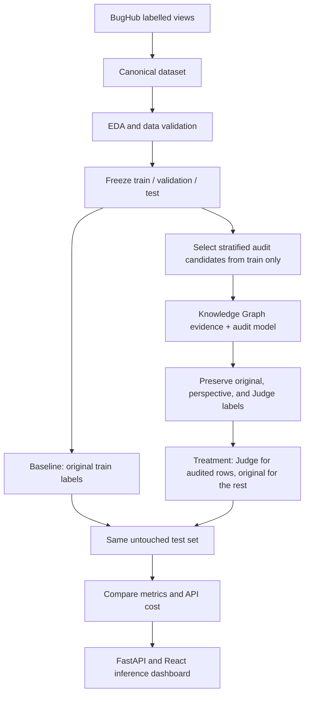

# Multi-Agent Software Defect Prediction

This research project studies whether auditing BugHub issue labels with language-model reasoning can improve a Software Defect Prediction (SDP) classifier.

The experiment compares two models trained on the **same training issues and text features**:

- **Baseline:** BugHub's original source label for every training issue.
- **Treatment:** the Judge label for audited training issues and the original label for all other training issues.

BugHub's source labels are the project's starting labels. They are not assumed to be human-reviewed gold labels. Model-generated audit labels are also not ground truth unless separately verified.

## Project workflow



## Current state — 24 October 2026

| Stage | State and outcome |
|---|---|
| Canonical data and EDA | Complete. Canonical Parquet has 926,461 records: 648,841 `bug`, 277,620 `non-bug`. |
| Model-ready frozen split | Available: 648,424 train, 138,948 validation, 138,949 test (926,321 total; seed 42). |
| Baseline | Historical baseline model and metrics exist. They do not contain the test-identity hash needed to prove they use the current frozen test split. Retrain for the paired comparison. |
| Knowledge Graph | Micro and macro graph artifacts exist and are used to retrieve issue/project/component evidence. **Current label-derived graph statistics include validation/test data; see the leakage note below.** |
| Audit sampling | 5,000 training-only candidates across 79 projects; a nested, stratified 1,000-record sample was selected. |
| Agent audit | **200 of the 1,000** have been audited so far. The run was stopped at 200 as requested; 800 remain. One model call produced three perspectives and a Judge decision per successful record. |
| Treatment dataset | Built over all 648,424 frozen training rows. It uses Judge labels for 200 rows and original labels for the other 648,224. This is provisional until the KG leakage issue is corrected. |
| Paired treatment training/evaluation | Not run on the current treatment dataset. No current baseline-versus-treatment conclusion is available. |
| Application | FastAPI backend and React frontend are present; production readiness is a separate task. |

### Current audit and treatment counts

The final 1,000-record candidate sample is nested within the 5,000-record training sample and stratified by project and original label. Current audit outputs contain 200 unique records with valid `bug`/`non-bug` values and confidence scores:

| Quantity | Current value |
|---|---:|
| Audited records | 200 |
| Original labels: bug / non-bug | 123 / 77 |
| Judge labels: bug / non-bug | 99 / 101 |
| Judge labels differing from original | 38 (19% of audited records) |
| Coverage of the 648,424-record training split | 0.0308% |
| Treatment training rows | 648,424 |

These checks establish output validity and that the audited issues are in the training split. They do **not** establish that each model-generated decision is correct. All three auditor perspectives and the Judge were generated by the same model call; they are not independent agents. Confidence values are not calibrated probabilities.

Audit cost has not been finalized. The `api_usage.json` in the current audit directory predates the 200-record checkpoint and should not be cited as the total usage for those 200 records.

### Important evaluation limitation: Knowledge Graph leakage

The audit candidates themselves come only from the training split. However, the current Knowledge Graph retriever reads `data/processed/audit_sample.parquet`, a 5,000-row sample that overlaps the frozen split as follows:

```text
train: 3,527 rows
validation: 773 rows
test: 698 rows
```

The retriever computes project/component defect rates from those original labels. It also queries macro Knowledge Graph statistics built across the full 926,461-record population. Therefore, test-derived labels can influence graph evidence shown to the audit model. The current 200 audit labels and treatment dataset are **not yet safe to use as a leakage-free final experiment**.

Before reporting a baseline-versus-treatment result, rebuild label-derived graph evidence from the frozen training split only, audit with that graph version, rebuild the treatment dataset, then freshly train both models and verify the same test identity hash. The current 200 records are a preliminary run and should not be mixed with labels generated from a corrected train-only graph without an explicit methodology decision.

## Data and labels

The source dataset is assembled from BugHub's labelled views:

```text
issues.vw_bugzilla_data
issues.vw_github_data
issues.vw_jira_data
```

The project uses the processed canonical dataset, not the entire BugHub population. Important files and invariants:

```text
Canonical dataset: data/processed/bughubs_canonical.parquet
Frozen splits:     data/processed/fixed_splits/{train,validation,test}.parquet
Split manifest:    data/processed/fixed_splits/split_manifest.json
Issue identity:    (source, project, issue_id)
Model text:        model_text = title + description
Labels:            bug / non-bug
```

`original_label` is preserved in the treatment dataset. The builder adds `audited_label`, `treatment_label`, and `is_audited`; it does not replace the source label. Validation and test files are not written by the treatment builder.

## Models and experimental protocol

### Baseline

The existing baseline pipeline uses `model_text` as input, extracts frozen embeddings with `microsoft/deberta-v3-small`, and trains a regularized XGBoost classifier. Baseline training uses all 648,424 rows of the frozen training split with `original_label`. Validation is used for model selection/early stopping; test is reserved for evaluation.

An older baseline artifact reports accuracy **0.7852** and ROC-AUC **0.8301**. Its metrics do not include a test identity hash, so they cannot prove that this run used the current frozen test identities. Treat these as historical model results, not a paired result.

### Treatment

The current treatment dataset is:

```text
data/processed/fixed_splits/treatment_train.parquet
```

Its label rule is:

```text
if is_audited:
    treatment_label = audited_label  # Judge decision
else:
    treatment_label = original_label
```

This keeps the **full training set** for treatment training; the 200 audited issues provide revised labels for only those rows. The baseline and treatment should use the same DeBERTa embeddings, XGBoost settings, training identities, validation set, and untouched test identities. The intended experimental difference is the training target labels.

Historical treatment artifacts describe a separate 5,000-row experiment with 20 audited labels, a 3,500/750/750 split, and different training details. They are not comparable to the historical full-data baseline and are not results for the current treatment dataset.

Do not interpret a gain in predictive metrics as proof that the audit labels are correct. Without an independently verified label set, the experiment measures downstream model changes associated with this label-replacement procedure.

## Knowledge Graph and audit method

Graph code is under `src/knowledge_graph/`. Existing artifacts include:

```text
Micro audit graph: outputs/knowledge_graph/kg_audit_sample.json
Macro graph data:  data/knowledge_graph/kg_macro_triples.csv
Macro summary:     outputs/knowledge_graph/kg_macro_summary.json
Retriever:         src/knowledge_graph/retriever.py
```

The micro graph represents issue, project, source, component, severity, priority, status, and resolution relationships. The macro graph contains project/component/label relations and aggregated statistics. The retriever supplies project, component, severity, and graph-cluster context to audit prompts. For controlled evaluation, label-derived statistics must be built from training data only.

The current one-call audit protocol returns:

```text
Policy perspective + Data perspective + Pattern perspective + Judge decision
```

The perspectives are organized roles in one model response, not four independent agents. The output keeps each perspective, evidence, Judge decision, original label, confidence, and whether the Judge changed the label.

## Reproduce the workflow

Run commands from the repository root. Keep `.env` local and never commit API keys or database credentials.

### Environment and data preparation

Install the project dependencies and configure database access if rebuilding data. The database is `bughub`; the project schema is `agenttriage`; the canonical table is `agenttriage.canonical_dataset`.

```powershell
python -m venv .venv
.venv\Scripts\activate
pip install -r requirements.txt
python src/preprocessing/validate_canonical_parquet.py
python src/eda/run_eda_pipeline.py
```

EDA output: `outputs/reports/EDA_Report.html`.

### Freeze or reuse the split

The checked-in split manifest records the current split. Do not recreate it during a paired experiment; both models must load the same split files.

```powershell
python -m src.baseline.data_splitter --dataset data/processed/bughubs_canonical.parquet --split-dir data/processed/fixed_splits --seed 42
```

### Select training-only audit candidates

The 5,000-row queue is selected from `train.parquet`; the 1,000-row candidate sample is nested within that queue.

```powershell
python -m src.audit_sampling.create_audit_sample --dataset data/processed/fixed_splits/train.parquet --sample-output data/processed/audit_train_sample.parquet --summary-output outputs/results/audit_sampling/audit_train_sample_summary.json --ids-output outputs/results/audit_sampling/audit_train_sample_ids.csv --sample-size 5000 --random-seed 42
python -m src.audit_sampling.create_audit_sample --dataset data/processed/audit_train_sample.parquet --sample-output data/processed/audit_train_sample_1000_from_5000.parquet --summary-output outputs/results/audit_sampling/audit_train_sample_1000_from_5000_summary.json --ids-output outputs/results/audit_sampling/audit_train_sample_1000_from_5000_ids.csv --sample-size 1000 --random-seed 42
```

### Run or resume an audit

The current run used Groq and is checkpointed under `outputs/results/audited_train_1000_onecall/`. After fixing the Knowledge Graph leakage, update/rebuild the graph and audit sample before starting a methodologically valid run.

```powershell
python -m src.agents.orchestrator --config configs/agents_config.yaml --batch-size 5
```

The orchestrator skips identities already present in its audited Parquet checkpoint. `GROQ_API_KEY` must be set in `.env`. Gemini support is available through `configs/agents_gemini_resume.yaml` and requires `GEMINI_API_KEY`; do not run both providers against the same output checkpoint at once.

### Build and train the treatment

After auditing with a train-only graph, rebuild the treatment dataset from the complete frozen training split. `--overwrite` is needed when rebuilding an existing file.

```powershell
python -m src.treatment.build_treatment_dataset --overwrite
python -m src.baseline.run_baseline --config configs/baseline_config.yaml
python -m src.treatment.train_treatment_model --dataset-path data/processed/fixed_splits/treatment_train.parquet --config configs/baseline_config.yaml
python -m src.treatment.compare_baseline_treatment
```

The comparison script checks the test-set identity hash and test row count. If either differs or is missing, it refuses to produce a valid paired comparison. Save the resulting metrics and audit API usage with the experiment configuration and graph version.

## Existing outputs

| Purpose | Path |
|---|---|
| 5,000 training-only audit candidates | `data/processed/audit_train_sample.parquet` |
| Nested 1,000 candidate sample | `data/processed/audit_train_sample_1000_from_5000.parquet` |
| Current 200-record audit checkpoint (JSON) | `outputs/results/audited_train_1000_onecall/audited_records.json` |
| Current 200-record audit checkpoint (Parquet) | `data/processed/audited_train_1000_onecall_labels.parquet` |
| Current full treatment training set | `data/processed/fixed_splits/treatment_train.parquet` |
| Current treatment data summary | `outputs/results/treatment/treatment_dataset_summary_current.json` |
| Historical baseline metrics | `outputs/results/baseline/full/metrics.json` |
| Historical 20-label treatment metrics | `outputs/results/treatment/metrics.json` |

No final API usage or audit metrics summary is available for the 200-record checkpoint. The orchestrator writes these summaries after a run completes.

## API and dashboard

Start the backend:

```powershell
python -m uvicorn backend.main:app --host 127.0.0.1 --port 8001
```

Start the frontend in another shell:

```powershell
cd frontend
$env:VITE_API_BASE_URL="http://127.0.0.1:8001"
npm run dev -- --host 127.0.0.1
```

The API includes health, project status, dataset/baseline reports, audit overview/cases, model comparison, predictions, and review endpoints. OpenAPI documentation is available at `http://127.0.0.1:8001/docs`; the frontend usually serves at `http://127.0.0.1:5173/`.

## Data safety and reproducibility rules

- Preserve BugHub's `original_label`; never overwrite it with audit or prediction output.
- Use `(source, project, issue_id)` as the composite issue identity.
- Keep baseline and treatment labels, outputs, and model artifacts separate.
- Select audit candidates from the frozen training split only.
- Do not use test-derived labels or aggregates in audit evidence, prompts, training, or tuning.
- Keep validation/test labels original for both models; evaluate both on identical test identities.
- Report model-generated audit labels as audit decisions, not human ground truth.
- Record split manifest, random seed, model/provider, prompt version, graph version, API usage, and metrics for each run.
- Never commit `.env`, keys, tokens, raw BugHub dumps, or large data/embedding artifacts.
