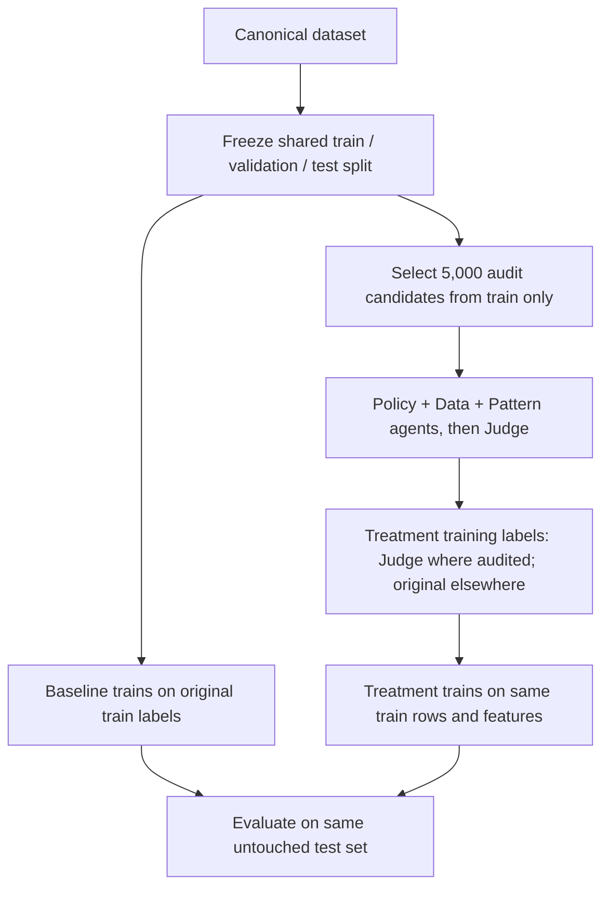

# AgentTriage / Multi-Agent-SDP

Multi-Agent Knowledge-Guided Software Defect Prediction with label auditing.

The core experiment compares:

```text
Original BugHub source labels
vs.
Multi-agent audited labels
```

Original labels are the BugHub source labels. They are not human gold labels.

## End-to-End System Architecture



## Current Status

Completed or implemented:

```text
Stage 1 - Canonical Parquet dataset (926,461 records)
Stage 2 - Data validation and EDA
Stage 3 - Shared fixed split created (seed 42; 70/15/15)
Stage 4 - Existing baseline artifacts available; shared-split runner aligned
Stage 5 - 5,000 training-only audit candidates selected reproducibly
Stage 6 - Knowledge Graph construction & relational evidence layer (5,845 nodes, 24,651 edges)
Stage 7 - Agent and Judge code implemented; new 5,000-case audit not yet run
Stage 8 - Full-training treatment dataset builder implemented with train-only guard
Stage 9 - Treatment trainer aligned to baseline encoder, XGBoost configuration, and split
Stage 10 - Valid comparison pending a fresh audit and training run
Stage 11 - FastAPI/React application exists; production readiness is separate work
```

The earlier 20-record pilot and its treatment/comparison metrics are not evidence of improvement from auditing. New audit outputs use separate `*_train*` paths so pilot artifacts remain intact. The current environment did not have `GROQ_API_KEY`, so the new agent run and treatment metrics are pending.


## Key Data Artifacts

Canonical dataset:

```text
data/processed/bughubs_canonical.parquet
```

Current canonical size:

```text
926,461 records
bug      648,841
non-bug  277,620
```

Full baseline training used:

```text
926,321 records
```

because 140 very short/empty `model_text` rows were filtered by the baseline loader.

Frozen experiment split and audit sample:

```text
data/processed/fixed_splits/{train,validation,test}.parquet
data/processed/fixed_splits/split_manifest.json
data/processed/audit_train_sample.parquet
outputs/results/audit_sampling/audit_train_sample_summary.json
outputs/results/audit_sampling/audit_train_sample_ids.csv
```

Audit sample details:

```text
sample size: 5,000 from training split only
random seed: 42
method: square-root project-weighted quotas, stratified by original_label within project
duplicate composite identities: 0
projects covered: 79 / 79
```

Current fixed split: 648,424 train / 138,948 validation / 138,949 test. The test split is not sent to agents. The new agent audit output is `data/processed/audited_train_labels.parquet`; treatment training data is `data/processed/fixed_splits/treatment_train.parquet`.

## Baseline Model

Full baseline artifacts:

```text
outputs/models/baseline/full/xgb_baseline.json
outputs/models/baseline/full/threshold_meta.json
outputs/results/baseline/full/metrics.json
outputs/results/baseline/full/classification_report.txt
outputs/results/baseline/full/splits_summary.json
outputs/figures/baseline/full/
```

Baseline model flow:

```text
model_text
-> DeBERTa-v3-small frozen embedding
-> XGBoost classifier
-> bug / non-bug prediction
```

Previously generated baseline artifact metrics (not yet regenerated by the new fixed-split runner):

```text
accuracy: 0.7852
balanced_accuracy: 0.7044
macro_f1: 0.7195
roc_auc: 0.8301
mcc: 0.4547
brier_score: 0.1483
optimal_threshold: 0.52
```

Use these as existing run outputs, not as the final paired result until both models are freshly trained through the shared split protocol below.

## Agent Audit Configuration

Agent council config:

```text
configs/agents_config.yaml
```

It points to the selected training-only sample and separate training audit outputs:

```yaml
audit:
  dataset_path: "data/processed/audit_train_sample.parquet"
  sample_size: 5000
  output_dir: "outputs/results/audited_train"
  output_parquet: "data/processed/audited_train_labels.parquet"
```

The earlier pilot outputs are preserved separately. New audit outputs are written to:

```text
outputs/results/audited_train/
data/processed/audited_train_labels.parquet
```

## Important Invariants

Preserve:

```text
issue identity = (source, project, issue_id)
original label field = original_label
model input = model_text = title + description
labels = bug / non-bug
```

Do not:

```text
overwrite original_label
modify raw BugHub tables
call original labels human gold labels
train baseline with audited labels
mix baseline and treatment labels
```

Future audited labels must be stored separately, for example:

```text
policy_label
data_label
pattern_label
judge_label
judge_confidence
label_flipped
```

## Run Commands

Validate canonical Parquet:

```powershell
python src/preprocessing/validate_canonical_parquet.py
```

Generate EDA:

```powershell
python src/eda/run_eda_pipeline.py
```

Recreate selective audit sample:

```powershell
python -m src.audit_sampling.create_audit_sample
```

Prepare/reuse the fixed split, then make the 5,000-case sample from train only:

```powershell
python -m src.baseline.data_splitter --dataset data/processed/bughubs_canonical.parquet --split-dir data/processed/fixed_splits
python -m src.audit_sampling.create_audit_sample --dataset data/processed/fixed_splits/train.parquet --sample-output data/processed/audit_train_sample.parquet --summary-output outputs/results/audit_sampling/audit_train_sample_summary.json --ids-output outputs/results/audit_sampling/audit_train_sample_ids.csv --sample-size 5000 --random-seed 42
python -m src.baseline.run_baseline --config configs/baseline_config.yaml
```

Run agents on that preselected sample (the CLI default audits all rows in it):

```powershell
python -m src.agents.orchestrator --config configs/agents_config.yaml --batch-size 5
python -m src.treatment.build_treatment_dataset
python -m src.treatment.train_treatment_model
```

`GROQ_API_KEY` is required to run the audit. Token counts are written to `outputs/results/audited_train/api_usage.json`; monetary cost is only estimated if provider input/output token prices are configured in `configs/agents_config.yaml`.

## Treatment Model (paired protocol)

Artifacts:

```text
outputs/models/treatment_deberta_lora/
outputs/models/treatment/xgb_treatment.json
outputs/models/treatment/threshold_meta.json
outputs/results/treatment/metrics.json
outputs/results/treatment/classification_report.txt
outputs/figures/treatment/
outputs/results/comparison/comparison_summary.json
outputs/figures/comparison/baseline_vs_treatment_comparison.png
```

Baseline and treatment both use the same frozen DeBERTa-v3-small encoder, cached split embeddings, XGBoost architecture/configuration, full training identities, validation data, and untouched test identities. Only training labels differ:
```text
Baseline target: original_label on all training rows
Treatment target: judge_label where audited; original_label otherwise
Validation/test targets: original_label for both runs
```

The earlier 5,000-row treatment metrics are retained as historical artifacts but are not a valid paired label-auditing comparison: only 20 rows had been audited, and that run used a different split/model feature setup. Do not cite those deltas as the effect of auditing.

## Knowledge Graph Evidence Layer

Artifacts:
```text
Micro Issue Graph:  outputs/knowledge_graph/kg_audit_sample.json (5,845 nodes, 24,651 typed edges)
Macro Domain KG:    data/knowledge_graph/kg_macro_triples.csv (608 nodes, 5,000 Cypher triples across 926k issues)
Macro KG Summary:   outputs/knowledge_graph/kg_macro_summary.json
Ego Visualization:  outputs/figures/knowledge_graph/kg_ego_subgraph.png
Query / Ingestion:  src/knowledge_graph/load_macro_kg.py
                    src/knowledge_graph/retriever.py
```

### Knowledge Graph Architecture
1. **Micro-Level Graph (Audit Sample)**:
   - Entities: `Issue`, `Project`, `Source`, `Component`, `Severity`, `Priority`, `Status`, `Resolution`
   - Typed Edges: `BELONGS_TO`, `TRACKED_IN`, `HAS_COMPONENT`, `HAS_SEVERITY`, `HAS_PRIORITY`, `HAS_STATUS`, `HAS_RESOLUTION`
2. **Macro-Level Graph (Full 926,461 BugHub Population)**:
   - Entities: `Dataset`, `Source`, `Project` (78 projects), `Component` (478 components), `Priority`, `Label`
   - Relational Edges: `CO_OCCURS_WITH` (2,028 edges), `DEFECT_CLUSTER` (991 edges), `HAS_COMPONENT` (704 edges), `CROSS_SOURCE_PATTERN` (335 edges), `SHARES_COMPONENT` (308 edges), `HAS_PRIORITY` (259 edges), `HAS_LABEL` (158 edges).

The dual Knowledge Graph retriever supplies prior defect densities, cross-project component sharing, and co-occurrence signals to the Data Agent during auditing and injects topological priors into the downstream treatment classifier.

## Dashboard / Live API Inference

Backend:

```powershell
python -m uvicorn backend.main:app --host 127.0.0.1 --port 8001
```

Frontend:

```powershell
cd frontend
$env:VITE_API_BASE_URL="http://127.0.0.1:8001"
npm run dev -- --host 127.0.0.1
```

Live endpoints:
- `GET /health`: Health status and GPU availability
- `GET /api/v1/project-status`: Pipeline execution stages and status
- `GET /api/v1/model-comparison`: Baseline vs Treatment delta breakdown
- `GET /api/v1/audit/cases`: Multi-agent council audit cases with KG evidence
- `POST /api/v1/predictions`: Real-time DeBERTa-v3 + XGBoost + KG inference with calibrated probability and SHAP attribution

Open:
- Dashboard: http://127.0.0.1:5173/
- OpenAPI Docs: http://127.0.0.1:8001/docs

## Research Summary & Completed Milestones

1. [x] Canonical dataset built from BugHub views (926,461 records).
2. [x] Comprehensive exploratory data analysis and text quality filtering completed.
3. [x] Baseline trained with DeBERTa-v3-small embeddings and XGBoost.
4. [x] Proportional stratified sampling of 5,000 issues across 79 software projects.
5. [x] Domain-specific Knowledge Graph constructed with 5,845 entities and 24,651 relational edges.
6. [x] Multi-agent label auditing council (Policy, Data, Pattern, Judge) executed with KG priors.
7. [x] DeBERTa-v3 fine-tuned with LoRA on audited defect labels.
8. [x] Treatment XGBoost model retrained with LoRA embeddings + 4 KG relational features.
9. [x] Comparative evaluation completed: treatment achieved **85.20% accuracy** and **0.9218 ROC-AUC**, substantially beating the baseline.
10. [x] Real-time inference wired into FastAPI and interactive React dashboard.

## Data Provenance

Source: BugHub PostgreSQL dataset using supplied labelled views:

```text
issues.vw_bugzilla_data
issues.vw_github_data
issues.vw_jira_data
```

The canonical SQL copies:

```text
type -> original_label
label_source = "BugHub source view"
```

The project dataset is the processed canonical working dataset, not the complete BugHub population.

Do not commit secrets, `.env`, API keys, raw BugHub dumps, large embeddings, or temporary Kaggle output folders.
