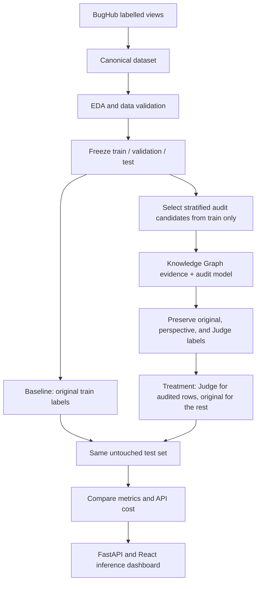

# Multi-Agent Software Defect Prediction

This research project studies whether auditing BugHub issue labels with language-model reasoning can improve a Software Defect Prediction (SDP) classifier.

The experiment is designed to compare two models trained on the **same training identities and text features**, changing only training labels. The retained model artifacts share test identities, but their XGBoost configurations differ; a matched treatment rerun is still needed before claiming a controlled comparison.

- **Baseline:** BugHub's original source label for every training issue.
- **Treatment:** the Judge label for audited training issues and the original label for all other training issues.

BugHub's source labels are the project's starting labels. They are not assumed to be human-reviewed gold labels. Model-generated audit labels are also not ground truth unless separately verified.

## Project workflow



## Current state — 28 October 2026

| Stage | State and outcome |
|---|---|
| Canonical data and EDA | Complete. Canonical Parquet has 926,461 records: 648,841 `bug`, 277,620 `non-bug`. |
| Model-ready frozen split | Available: 648,424 train, 138,948 validation, 138,949 test (926,321 total; seed 42). |
| Baseline | Locally trained and tuned on CUDA using the frozen split. Current held-out accuracy 0.8043, ROC-AUC 0.8561, macro-F1 0.7546. Model/results are retained under `outputs/models/baseline/fixed_split/tuned_xgboost/` and `outputs/results/baseline/fixed_split/tuned_xgboost/`. |
| Knowledge Graph | Rebuilt from the 648,424 frozen training rows only. The audit retriever now reads this split and excludes each target issue from its own label-derived priors. Artifacts are under `outputs/knowledge_graph/train_only/`. |
| Audit sampling | 5,000 training-only candidates across 79 projects; a nested, stratified 1,000-record sample was selected. |
| Agent audit | Complete for 1,000 training-only records using **one LLM call that returns Policy, Data, Pattern, and Judge perspectives**. 170 Judge labels differ from the preserved source labels (17%). The perspectives are not independent model calls or statistical measurements. |
| Treatment dataset | Built from all 648,424 frozen training records. Judge labels are used for the 1,000 audited identities; source labels remain for the other 647,424. Original labels are preserved; validation and test labels are unchanged. |
| Treatment model | Trained and evaluated on the frozen 138,949-row test set. Accuracy 0.7850, balanced accuracy 0.7183, macro-F1 0.7291, ROC-AUC 0.8300, MCC 0.4644, Brier score 0.1483. Artifacts are under `outputs/models/treatment/` and `outputs/results/treatment/`. |
| Comparison status | Treatment and tuned baseline metrics have matching test identity hashes, but treatment uses the regular `baseline_config.yaml` XGBoost settings while baseline uses separately tuned parameters. Treat their metric contrast as **not a fully controlled matched-model comparison** until treatment is retrained with the tuned baseline parameters. The existing comparison chart uses older baseline metrics and must not be presented as the current tuned comparison. |
| Application | FastAPI backend and React frontend are present. Treatment inference uses the local treatment model; low-confidence review and OOD detection remain disabled pending validated thresholds. |

### Current audit and treatment counts

The selected 1,000-record audit sample is nested within the 5,000-record training sample, stratified by project and original label, and verified to contain unique identities from the frozen training split. The completed audit records are in `outputs/results/audited_train_1000_onecall/audited_records.json`; the treatment dataset summary is in `outputs/results/treatment/treatment_dataset_summary_current.json`.

The new training-only graph is built with `python -m src.knowledge_graph.build_training_kg`. It reads only `data/processed/fixed_splits/train.parquet`; the retriever excludes the current issue's original label from its own project/component/severity rates. The previous mixed-split graph artifacts are historical and are not used by the new audit retriever.

## Data and labels

The source dataset is assembled from BugHub's labelled views:

```text
issues.vw_bugzilla_data
issues.vw_github_data
issues.vw_jira_data
```

The project uses the processed canonical dataset, not the entire BugHub population. Important files and invariants:

```text
Canonical dataset: data/processed/bughubs_canonical.parquet
Frozen splits:     data/processed/fixed_splits/{train,validation,test}.parquet
Split manifest:    data/processed/fixed_splits/split_manifest.json
Issue identity:    (source, project, issue_id)
Model text:        model_text = title + description
Labels:            bug / non-bug
```

`original_label` is preserved in the treatment dataset. The builder adds `audited_label`, `treatment_label`, and `is_audited`; it does not replace the source label. Validation and test files are not written by the treatment builder.

## Models and experimental protocol

### Baseline

The existing baseline pipeline uses `model_text` as input, extracts frozen embeddings with `microsoft/deberta-v3-small`, and trains a regularized XGBoost classifier. Baseline training uses all 648,424 rows of the frozen training split with `original_label`. Validation is used for model selection/early stopping; test is reserved for evaluation.

The current baseline is the 15-trial tuned CUDA XGBoost model selected on validation ROC-AUC. Its held-out test accuracy is **0.8043**, ROC-AUC **0.8561**, and macro-F1 **0.7546**, on the frozen 138,949-row test split (identity SHA-256 `cc5b147ddba1b01bf252c0ab2d3b0b596bb3674a80458d8f3976208a2f53b0a1`). It uses all 648,424 frozen training rows with `original_label`. The current model and threshold are in `outputs/models/baseline/fixed_split/tuned_xgboost/`; metrics, best parameters, trial history, and classification report are in `outputs/results/baseline/fixed_split/tuned_xgboost/`. Older full-dataset and untuned fixed-split model outputs were removed to avoid ambiguity. Use this tuned configuration for any paired treatment comparison.

### Treatment

The retained treatment dataset and model use the completed one-call, four-perspective audit. For each audited training identity, the Judge label replaces the training target; other training rows retain their source label:

```text
if identity has a valid Judge audit:
    treatment_label = judge_label
else:
    treatment_label = original_label
```

Keep `original_label` unchanged. The retained treatment uses the same frozen split identities and DeBERTa text embeddings, but its saved run used the regular `baseline_config.yaml` XGBoost configuration rather than the tuned baseline parameters. Retrain it with the tuned parameters and the same validation-based threshold-selection policy before interpreting the paired results as isolating label changes.

Do not interpret a gain in predictive metrics as proof that the audit labels are correct. Without an independently verified label set, the experiment measures downstream model changes associated with this label-replacement procedure.

## Knowledge Graph and audit method

Graph code is under `src/knowledge_graph/`. The current leakage-controlled training graph is built with `python -m src.knowledge_graph.build_training_kg` and stored in `outputs/knowledge_graph/train_only/`. It has project, component, source, and severity aggregates derived only from the frozen training split. The retrieval layer also uses training rows and leaves the target issue out of its own original-label rate calculation.

Older artifacts include:

```text
Micro audit graph: outputs/knowledge_graph/kg_audit_sample.json
Macro graph data:  data/knowledge_graph/kg_macro_triples.csv
Macro summary:     outputs/knowledge_graph/kg_macro_summary.json
Retriever:         src/knowledge_graph/retriever.py
```

The micro graph represents issue, project, source, component, severity, priority, status, and resolution relationships. The macro graph contains project/component/label relations and aggregated statistics. The retriever supplies project, component, severity, and graph-cluster context to audit prompts. For controlled evaluation, label-derived statistics must be built from training data only.

The completed audit protocol uses one LLM API call per issue and returns four role perspectives:

```text
Policy perspective + Data/KG perspective + Pattern/Skeptic perspective + Judge decision
```

These are structured roles within one model response, not separate calls or statistically independent agents. The retained audit records identify the method as `single_model_four_perspective_one_call`.

One model call produces the three perspective outputs and Judge decision. The saved record preserves each perspective and rationale, the source label, confidence fields, audit method, and label-change flag. The audit prompt includes the original source label as context, so label anchoring is a validity limitation. The confidence values have not been established as calibrated probabilities.

## Reproduce the workflow

Run commands from the repository root. Keep `.env` local and never commit API keys or database credentials.

### Environment and data preparation

Install the project dependencies and configure database access if rebuilding data. The database is `bughub`; the project schema is `agenttriage`; the canonical table is `agenttriage.canonical_dataset`.

```powershell
python -m venv .venv
.venv\Scripts\activate
pip install -r requirements.txt
python src/preprocessing/validate_canonical_parquet.py
python src/eda/run_eda_pipeline.py
```

EDA output: `outputs/reports/EDA_Report.html`.

### Freeze or reuse the split

The checked-in split manifest records the current split. Do not recreate it during a paired experiment; both models must load the same split files. The current baseline has already been trained locally on CUDA from these frozen splits.

Reuse the existing split files; do not rerun splitting when preparing a paired treatment experiment. Kaggle training instructions and notebook have been removed because the current baseline was trained and tuned locally.

Inference can initially run locally: apply the same `model_text` construction, extract first-token embeddings with the frozen `microsoft/deberta-v3-small` checkpoint, pass embeddings to `xgb_baseline_tuned.json`, and classify using the threshold in `outputs/models/baseline/fixed_split/tuned_xgboost/threshold_meta.json`. The pretrained DeBERTa checkpoint must be downloadable or cached locally. Deployment is optional; after validating local batch inference, the model can be integrated into the existing application/API. The current repository has no dedicated baseline inference service yet.

### Select training-only audit candidates

The 5,000-row queue is selected from `train.parquet`; the 1,000-row candidate sample is nested within that queue.

```powershell
python -m src.audit_sampling.create_audit_sample --dataset data/processed/fixed_splits/train.parquet --sample-output data/processed/audit_train_sample.parquet --summary-output outputs/results/audit_sampling/audit_train_sample_summary.json --ids-output outputs/results/audit_sampling/audit_train_sample_ids.csv --sample-size 5000 --random-seed 42
python -m src.audit_sampling.create_audit_sample --dataset data/processed/audit_train_sample.parquet --sample-output data/processed/audit_train_sample_1000_from_5000.parquet --summary-output outputs/results/audit_sampling/audit_train_sample_1000_from_5000_summary.json --ids-output outputs/results/audit_sampling/audit_train_sample_1000_from_5000_ids.csv --sample-size 1000 --random-seed 42
```

### Run or resume an audit

Build the training-only graph first, then use the one-call four-perspective audit runner when repeating the audit. Configure provider credentials through environment variables; do not put secrets in version-controlled files. The retained completed audit is the one-call run described above. `src/agents/orchestrator.py` represents the older separate-call workflow; its failed attempt is not the source of treatment labels.

```powershell
python -m src.knowledge_graph.build_training_kg
python -m src.agents.audit_remaining_800
```

The completed records are retained at `outputs/results/audited_train_1000_onecall/audited_records.json`. The command above is for rerunning/resuming this one-call audit path; check provider access and its configured checkpoint paths before launching it. The separate-call orchestrator is not the method used for current treatment labels.

The audit runner's automatic treatment-build callback currently invokes the dataset builder without overriding its older separate-call JSON default. If rerunning from scratch, verify that callback's input path or run the explicit treatment-build command below with `--audited-json outputs/results/audited_train_1000_onecall/audited_records.json`.

### Build and train the treatment

After auditing with a train-only graph, rebuild the treatment dataset from the complete frozen training split. `--overwrite` is needed when rebuilding an existing file.

```powershell
python -m src.treatment.build_treatment_dataset --audited-json outputs/results/audited_train_1000_onecall/audited_records.json --overwrite
python -m src.treatment.train_treatment_model --dataset-path data/processed/fixed_splits/treatment_train.parquet --config configs/baseline_config.yaml
python -m src.treatment.compare_baseline_treatment --baseline-metrics outputs/results/baseline/fixed_split/tuned_xgboost/metrics.json --treatment-metrics outputs/results/treatment/metrics.json
```

The treatment command above reproduces the retained treatment configuration; it does not yet match the tuned baseline parameters. Do not use its generated chart to claim an isolated label-treatment effect. First train treatment with the tuned baseline XGBoost parameters and threshold-selection procedure. The comparison script checks matching test identity hashes and row counts, but those checks alone do not ensure matched model configurations.

## Existing outputs

| Purpose | Path |
|---|---|
| 5,000 training-only audit candidates | `data/processed/audit_train_sample.parquet` |
| Nested 1,000 candidate sample | `data/processed/audit_train_sample_1000_from_5000.parquet` |
| 5,000 training-only candidates | `data/processed/audit_train_sample.parquet` |
| Nested 1,000 audit candidates | `data/processed/audit_train_sample_1000_from_5000.parquet` |
| Audit completion | 1,000 records from the one-call four-perspective run: `outputs/results/audited_train_1000_onecall/audited_records.json` |
| Treatment dataset/model | Retained one-call treatment artifacts: `data/processed/fixed_splits/treatment_train.parquet`, `outputs/results/treatment/`, and `outputs/models/treatment/` |
| Current tuned baseline metrics | `outputs/results/baseline/fixed_split/tuned_xgboost/metrics.json` |

The selected candidate samples and completed audit records are retained for reproducibility. Rebuild the treatment dataset only from valid Judge labels that match the frozen training audit sample.

### Shared data files

The frozen `train.parquet`, `validation.parquet`, and `test.parquet` files in `data/processed/fixed_splits/` are versioned with Git LFS; `split_manifest.json` records their row counts and identity hashes. Install Git LFS before cloning or pulling so the Parquet contents are downloaded. The completed 1,000-row single-call, four-perspective audit at `outputs/results/audited_train_1000_onecall/audited_records.json` is the source of current treatment labels.

For the current agent audit, `data/processed/audit_train_sample.parquet` is a reproducible 5,000-row sample from the frozen training split, and `data/processed/audit_train_sample_1000_from_5000.parquet` is the nested 1,000-row audit queue. Both use seed 42 and cover 79 projects; their selection summaries and identity lists are in `outputs/results/audit_sampling/`. One expired 2019 signed-download URL in a sampled issue had its AWS authentication query removed; the issue identity, label, and remaining text were preserved. The older `audit_sample.parquet` was sampled from the full canonical dataset, so it can include validation/test records and must not be used for agent training. The full canonical Parquet is not needed to run the audit or paired model experiment: the frozen split files and training-only samples provide the required inputs.

## API and dashboard

Start the backend:

```powershell
python -m uvicorn backend.main:app --host 127.0.0.1 --port 8000
```

Start the frontend in another shell:

```powershell
cd frontend
npm ci
npm run dev
```

The frontend defaults to the API at `http://127.0.0.1:8000`; override `VITE_API_BASE_URL` when using another port. OpenAPI documentation is available at `http://127.0.0.1:8000/docs`; the frontend usually serves at `http://127.0.0.1:5173/`. Treatment inference is available when the one-call audit provenance, treatment artifacts, and test identity checks pass. Low-confidence review and OOD detection remain disabled until validated thresholds are available. Matching test identities do not by themselves establish a controlled baseline/treatment comparison; treatment must also use the baseline's tuned classifier settings.

## Data safety and reproducibility rules

- Preserve BugHub's `original_label`; never overwrite it with audit or prediction output.
- Use `(source, project, issue_id)` as the composite issue identity.
- Keep baseline and treatment labels, outputs, and model artifacts separate.
- Select audit candidates from the frozen training split only.
- Do not use test-derived labels or aggregates in audit evidence, prompts, training, or tuning.
- Keep validation/test labels original for both models; evaluate both on identical test identities.
- Report model-generated audit labels as audit decisions, not human ground truth.
- Record split manifest, random seed, model/provider, prompt version, graph version, API usage, and metrics for each run.
- Never commit `.env`, keys, tokens, raw BugHub dumps, or large data/embedding artifacts.
