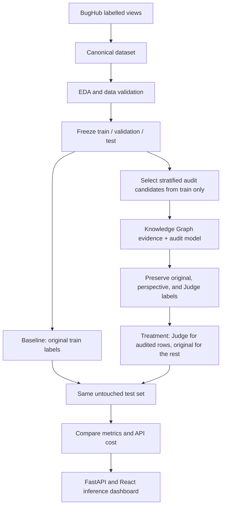

# Multi-Agent Software Defect Prediction

This research project studies whether auditing BugHub issue labels with language-model reasoning can improve a Software Defect Prediction (SDP) classifier.

The experiment compares two models trained on the **same training issues and text features**:

- **Baseline:** BugHub's original source label for every training issue.
- **Treatment:** the Judge label for audited training issues and the original label for all other training issues.

BugHub's source labels are the project's starting labels. They are not assumed to be human-reviewed gold labels. Model-generated audit labels are also not ground truth unless separately verified.

## Project workflow



## Current state — 26 October 2026

| Stage | State and outcome |
|---|---|
| Canonical data and EDA | Complete. Canonical Parquet has 926,461 records: 648,841 `bug`, 277,620 `non-bug`. |
| Model-ready frozen split | Available: 648,424 train, 138,948 validation, 138,949 test (926,321 total; seed 42). |
| Baseline | Locally trained and tuned on CUDA using the frozen split. Current held-out accuracy 0.8043, ROC-AUC 0.8561, macro-F1 0.7546. Model/results are retained under `outputs/models/baseline/fixed_split/tuned_xgboost/` and `outputs/results/baseline/fixed_split/tuned_xgboost/`. |
| Knowledge Graph | Rebuilt from the 648,424 frozen training rows only. The audit retriever now reads this split and excludes each target issue from its own label-derived priors. Artifacts are under `outputs/knowledge_graph/train_only/`. |
| Audit sampling | 5,000 training-only candidates across 79 projects; a nested, stratified 1,000-record sample was selected. |
| Agent audit | The new runner is configured for 1,000 unique training-only candidates and four separate role calls. The first attempt produced **0 audited labels**: Gemini returned HTTP 403 stating its free tier is unavailable for the supplied project. The earlier audit outputs from 20-record and 200-record protocols have been removed because they do not meet the current four-separate-call audit protocol. |
| Treatment dataset | To be rebuilt after the new 1,000-record audit completes: full training split, Judge labels for audited rows, original labels elsewhere. |
| Paired treatment training/evaluation | Pending audit completion and treatment dataset rebuild. No current baseline-versus-treatment conclusion is available. |
| Application | FastAPI backend and React frontend are present; production readiness is a separate task. |

### Current audit and treatment counts

The selected 1,000-record candidate sample is nested within the 5,000-record training sample and stratified by project and original label. All 1,000 identities were verified to be unique and in the frozen training split. The separate-call audit has not produced labels yet. Its eventual completion count will be recorded in `data/processed/audited_train_1000_independent_calls_labels.parquet`.

The supplied Gemini credentials were rejected with HTTP 403 because the associated project does not have Gemini free-tier access. No treatment dataset should be rebuilt from this failed run. No valid audit labels or treatment dataset/model artifacts are currently retained. The earlier outputs from incompatible audit protocols were removed.

The new training-only graph is built with `python -m src.knowledge_graph.build_training_kg`. It reads only `data/processed/fixed_splits/train.parquet`; the retriever excludes the current issue's original label from its own project/component/severity rates. The previous mixed-split graph artifacts are historical and are not used by the new audit retriever.

## Data and labels

The source dataset is assembled from BugHub's labelled views:

```text
issues.vw_bugzilla_data
issues.vw_github_data
issues.vw_jira_data
```

The project uses the processed canonical dataset, not the entire BugHub population. Important files and invariants:

```text
Canonical dataset: data/processed/bughubs_canonical.parquet
Frozen splits:     data/processed/fixed_splits/{train,validation,test}.parquet
Split manifest:    data/processed/fixed_splits/split_manifest.json
Issue identity:    (source, project, issue_id)
Model text:        model_text = title + description
Labels:            bug / non-bug
```

`original_label` is preserved in the treatment dataset. The builder adds `audited_label`, `treatment_label`, and `is_audited`; it does not replace the source label. Validation and test files are not written by the treatment builder.

## Models and experimental protocol

### Baseline

The existing baseline pipeline uses `model_text` as input, extracts frozen embeddings with `microsoft/deberta-v3-small`, and trains a regularized XGBoost classifier. Baseline training uses all 648,424 rows of the frozen training split with `original_label`. Validation is used for model selection/early stopping; test is reserved for evaluation.

The current baseline is the 15-trial tuned CUDA XGBoost model selected on validation ROC-AUC. Its held-out test accuracy is **0.8043**, ROC-AUC **0.8561**, and macro-F1 **0.7546**, on the frozen 138,949-row test split (identity SHA-256 `cc5b147ddba1b01bf252c0ab2d3b0b596bb3674a80458d8f3976208a2f53b0a1`). It uses all 648,424 frozen training rows with `original_label`. The current model and threshold are in `outputs/models/baseline/fixed_split/tuned_xgboost/`; metrics, best parameters, trial history, and classification report are in `outputs/results/baseline/fixed_split/tuned_xgboost/`. Older full-dataset and untuned fixed-split model outputs were removed to avoid ambiguity. Use this tuned configuration for any paired treatment comparison.

### Treatment

No treatment dataset or trained treatment model is currently retained. After the valid four-call audit completes, build a treatment dataset from the complete frozen training split using:

```text
if identity has a valid Judge audit:
    treatment_label = judge_label
else:
    treatment_label = original_label
```

Keep `original_label` unchanged. Then train with the same DeBERTa embeddings, XGBoost settings, training identities, validation set, and untouched test identities as the baseline. The intended experimental difference is the training target labels.

Do not interpret a gain in predictive metrics as proof that the audit labels are correct. Without an independently verified label set, the experiment measures downstream model changes associated with this label-replacement procedure.

## Knowledge Graph and audit method

Graph code is under `src/knowledge_graph/`. The current leakage-controlled training graph is built with `python -m src.knowledge_graph.build_training_kg` and stored in `outputs/knowledge_graph/train_only/`. It has project, component, source, and severity aggregates derived only from the frozen training split. The retrieval layer also uses training rows and leaves the target issue out of its own original-label rate calculation.

Older artifacts include:

```text
Micro audit graph: outputs/knowledge_graph/kg_audit_sample.json
Macro graph data:  data/knowledge_graph/kg_macro_triples.csv
Macro summary:     outputs/knowledge_graph/kg_macro_summary.json
Retriever:         src/knowledge_graph/retriever.py
```

The micro graph represents issue, project, source, component, severity, priority, status, and resolution relationships. The macro graph contains project/component/label relations and aggregated statistics. The retriever supplies project, component, severity, and graph-cluster context to audit prompts. For controlled evaluation, label-derived statistics must be built from training data only.

The current audit protocol uses four separate calls per issue:

```text
Semantic Auditor + Skeptic Auditor + Structural/KG Auditor + Judge
```

The first three calls run independently of the Judge call; the Judge receives their verdicts and evidence, but not the original source label. “Separate calls” describes the execution protocol; shared providers/models do not establish statistical independence. The output preserves each verdict and rationale, the Judge decision, original label, confidence scores, and label-change flag.

## Reproduce the workflow

Run commands from the repository root. Keep `.env` local and never commit API keys or database credentials.

### Environment and data preparation

Install the project dependencies and configure database access if rebuilding data. The database is `bughub`; the project schema is `agenttriage`; the canonical table is `agenttriage.canonical_dataset`.

```powershell
python -m venv .venv
.venv\Scripts\activate
pip install -r requirements.txt
python src/preprocessing/validate_canonical_parquet.py
python src/eda/run_eda_pipeline.py
```

EDA output: `outputs/reports/EDA_Report.html`.

### Freeze or reuse the split

The checked-in split manifest records the current split. Do not recreate it during a paired experiment; both models must load the same split files. The current baseline has already been trained locally on CUDA from these frozen splits.

Reuse the existing split files; do not rerun splitting when preparing a paired treatment experiment. Kaggle training instructions and notebook have been removed because the current baseline was trained and tuned locally.

Inference can initially run locally: apply the same `model_text` construction, extract first-token embeddings with the frozen `microsoft/deberta-v3-small` checkpoint, pass embeddings to `xgb_baseline_tuned.json`, and classify using the threshold in `outputs/models/baseline/fixed_split/tuned_xgboost/threshold_meta.json`. The pretrained DeBERTa checkpoint must be downloadable or cached locally. Deployment is optional; after validating local batch inference, the model can be integrated into the existing application/API. The current repository has no dedicated baseline inference service yet.

### Select training-only audit candidates

The 5,000-row queue is selected from `train.parquet`; the 1,000-row candidate sample is nested within that queue.

```powershell
python -m src.audit_sampling.create_audit_sample --dataset data/processed/fixed_splits/train.parquet --sample-output data/processed/audit_train_sample.parquet --summary-output outputs/results/audit_sampling/audit_train_sample_summary.json --ids-output outputs/results/audit_sampling/audit_train_sample_ids.csv --sample-size 5000 --random-seed 42
python -m src.audit_sampling.create_audit_sample --dataset data/processed/audit_train_sample.parquet --sample-output data/processed/audit_train_sample_1000_from_5000.parquet --summary-output outputs/results/audit_sampling/audit_train_sample_1000_from_5000_summary.json --ids-output outputs/results/audit_sampling/audit_train_sample_1000_from_5000_ids.csv --sample-size 1000 --random-seed 42
```

### Run or resume an audit

Build the training-only graph first, then run the four separate agent calls. Configure the role-specific API credentials through the environment variable names in `configs/agents_config.yaml`; do not put secrets in version-controlled files. The supplied Gemini project currently returns HTTP 403 because its free tier is unavailable, so the full audit remains blocked until eligible Gemini credentials/access are available.

```powershell
python -m src.knowledge_graph.build_training_kg
python -m src.agents.orchestrator --config configs/agents_config.yaml --batch-size 5
```

The orchestrator skips identities already present in its audited Parquet checkpoint. Check that provider access works before starting a long run.

### Build and train the treatment

After auditing with a train-only graph, rebuild the treatment dataset from the complete frozen training split. `--overwrite` is needed when rebuilding an existing file.

```powershell
python -m src.treatment.build_treatment_dataset --overwrite
python -m src.baseline.run_baseline --config configs/baseline_fixed_split_config.yaml
python -m src.treatment.train_treatment_model --dataset-path data/processed/fixed_splits/treatment_train.parquet --config configs/baseline_config.yaml
python -m src.treatment.compare_baseline_treatment
```

The comparison script checks the test-set identity hash and test row count. If either differs or is missing, it refuses to produce a valid paired comparison. Save the resulting metrics and audit API usage with the experiment configuration and graph version.

## Existing outputs

| Purpose | Path |
|---|---|
| 5,000 training-only audit candidates | `data/processed/audit_train_sample.parquet` |
| Nested 1,000 candidate sample | `data/processed/audit_train_sample_1000_from_5000.parquet` |
| 5,000 training-only candidates | `data/processed/audit_train_sample.parquet` |
| Nested 1,000 audit candidates | `data/processed/audit_train_sample_1000_from_5000.parquet` |
| Audit completion | 0 valid labels from the current four-call attempt; see `outputs/logs/audit_1000_independent_calls.log` |
| Treatment dataset/model | Not built from the current audit; prior incompatible outputs were removed |
| Current tuned baseline metrics | `outputs/results/baseline/fixed_split/tuned_xgboost/metrics.json` |

The selected candidate samples remain available to resume the audit. Treatment data and models should be regenerated only after valid Judge labels are available.

### Shared data files

The frozen `train.parquet`, `validation.parquet`, and `test.parquet` files in `data/processed/fixed_splits/` are versioned with Git LFS; `split_manifest.json` records their row counts and identity hashes. Install Git LFS before cloning or pulling so the Parquet contents are downloaded. The historical 1,000-row audit output is tracked at `outputs/results/audited_train_1000_onecall/audited_records.json`; it was produced by a single-call four-perspective protocol and is not the current four-separate-call audit, so do not use it as the current treatment labels.

For the current agent audit, `data/processed/audit_train_sample.parquet` is a reproducible 5,000-row sample from the frozen training split, and `data/processed/audit_train_sample_1000_from_5000.parquet` is the nested 1,000-row audit queue. Both use seed 42 and cover 79 projects; their selection summaries and identity lists are in `outputs/results/audit_sampling/`. One expired 2019 signed-download URL in a sampled issue had its AWS authentication query removed; the issue identity, label, and remaining text were preserved. The older `audit_sample.parquet` was sampled from the full canonical dataset, so it can include validation/test records and must not be used for agent training. The full canonical Parquet is not needed to run the audit or paired model experiment: the frozen split files and training-only samples provide the required inputs.

## API and dashboard

Start the backend:

```powershell
python -m uvicorn backend.main:app --host 127.0.0.1 --port 8001
```

Start the frontend in another shell:

```powershell
cd frontend
$env:VITE_API_BASE_URL="http://127.0.0.1:8001"
npm run dev -- --host 127.0.0.1
```

The API includes health, project status, dataset/baseline reports, audit overview/cases, model comparison, predictions, and review endpoints. OpenAPI documentation is available at `http://127.0.0.1:8001/docs`; the frontend usually serves at `http://127.0.0.1:5173/`.

## Data safety and reproducibility rules

- Preserve BugHub's `original_label`; never overwrite it with audit or prediction output.
- Use `(source, project, issue_id)` as the composite issue identity.
- Keep baseline and treatment labels, outputs, and model artifacts separate.
- Select audit candidates from the frozen training split only.
- Do not use test-derived labels or aggregates in audit evidence, prompts, training, or tuning.
- Keep validation/test labels original for both models; evaluate both on identical test identities.
- Report model-generated audit labels as audit decisions, not human ground truth.
- Record split manifest, random seed, model/provider, prompt version, graph version, API usage, and metrics for each run.
- Never commit `.env`, keys, tokens, raw BugHub dumps, or large data/embedding artifacts.
